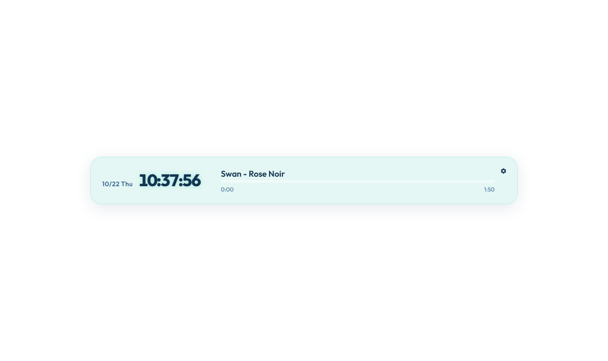
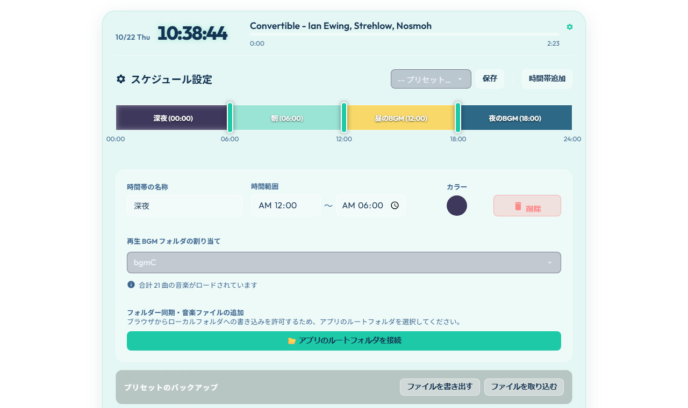

# Clock Player

時間帯（深夜・朝・昼・夜など）に合わせて、再生する BGM フォルダを自動で切り替える時計付きミュージックプレイヤーです。
ブラウザだけで動き、OBS のブラウザソースとして配信画面に時計と再生中の曲名を表示できます。

**デモ: https://tomozow.github.io/ClockPlayer/**
（デモには曲が入っていません。設定パネルの「曲を追加」から取り込むと再生できます）

## 主な機能

- 日付・時刻の表示と、再生中の曲名（アーティスト - タイトル）・シークバー
- 24時間のスケジュールバーで時間帯を作成し、境界をドラッグして切り替え時刻を調整
- 時間帯ごとに名前・色・再生する BGM フォルダ（`bgm/bgmA`〜`bgmF`）を割り当て
- 時間帯が変わると自動でフォルダを切り替えて再生、シャッフル・前/次の曲・ミュート
- スケジュールをプリセットとして保存、JSON で書き出し/取り込み
- ブラウザからフォルダを接続して音楽ファイルを追加・コピー（File System Access API）
- OBS 用の `obs.html`（左上寄せ・影の余白付き、OBS 側で音声を制御するモードあり）

## 使い方

1. このリポジトリをダウンロードし、`index.html` をブラウザで開きます
2. `bgm/bgmA`〜`bgm/bgmF` に音楽ファイル（mp3 / wav / m4a / flac など）を入れます
   - 手動で入れた場合は `update_bgm.bat` を実行して曲リスト（`bgm_manifest.js`）を作り直します
   - 設定パネルの「アプリのルートフォルダを接続」→「音楽ファイルの追加・コピー」から追加した場合は自動で更新されます
3. 右上の歯車から設定パネルを開き、時間帯とフォルダの割り当てを調整します

詳しい手順は [README.html](README.html)（取扱説明書）を参照してください。

## OBS で使う

1. ソースの「＋」→「ブラウザ」を追加
2. 「ローカルファイル」にチェックを入れ、`obs.html` を選択
3. サイズは幅 950、高さ 150（ミニマル表示）〜 440（通常表示）がおすすめです
4. BGM の音声を OBS で扱う場合は「OBSで音声を制御する」にチェックを入れます

### GitHub Pages 版を OBS で使う

ダウンロードせずに使う場合は、設定パネルを OBS のドックに、プレイヤーをブラウザソースに読み込みます。両者は同じページの保存領域を共有するので、ドックで取り込んだ曲と設定がそのままブラウザソースに反映されます。

1. 「ドック」→「カスタムブラウザドック」で `https://tomozow.github.io/ClockPlayer/index.html?dock` を追加（ドックでは曲名・操作ボタンと設定だけの簡易表示になります）
2. ブラウザソースを追加し、URL に `https://tomozow.github.io/ClockPlayer/obs.html` を指定（「ローカルファイル」は外す）。この URL はドックの設定の先頭からコピーできます
3. ドックの設定パネルで時間帯を選び、「曲を追加」「フォルダから追加」で曲を取り込む

曲はブラウザの保存領域にコピーされ、OBS を再起動しても残ります。容量はリストの左下に表示され、1曲ずつ・フォルダごと・すべてを削除できます。音はブラウザソースで鳴り、ドックの再生ボタンや曲送りはブラウザソースを操作します。

## ファイル構成

| ファイル | 内容 |
| --- | --- |
| `index.html` / `index.css` / `index.js` | プレイヤー本体 |
| `obs.html` | OBS ブラウザソース用の画面 |
| `library.js` | GitHub Pages 版で曲をブラウザの保存領域に置くためのライブラリ |
| `config.js` | 既定のスケジュール |
| `bgm_manifest.js` | 曲リスト（`update_bgm.bat` またはアプリが自動生成。リポジトリには含みません） |
| `update_bgm.bat` / `update_bgm.ps1` | `bgm` フォルダを走査して曲リストを作るスクリプト（Windows） |
